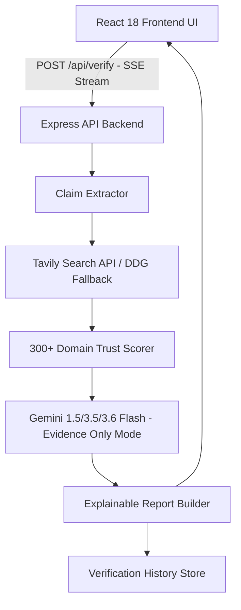

# hackindia-spark-11-hyderabad-telangana-south-central-region-tech-nova

<p align="center">

</p>

<h1 align="center">MUTAGENT / TruthLens</h1>

<p align="center">
<b>The Agentic Development Lifecycle</b> — build · evaluate · diagnose · optimize AI agents, all from one conversational orchestrator.
</p>

<p align="center">


</p>

---

## 🛡️ TruthLens — Retrieval-Augmented Verification (RAV) Platform

**TruthLens** is a premium, enterprise-grade AI SaaS application built for multi-modal information verification. It completely eliminates AI hallucination by enforcing a strict **Retrieval-Augmented Verification (RAV)** pipeline: the AI *never* decides truth based on internal memory; it retrieves real-time evidence from the internet, scores domain trust, and reasons strictly over verified evidence.

### 🌟 Key Capabilities

- **6-Stage Evidence Pipeline**: Claim Extraction → Live Tavily Web Search → 300+ Domain Trust Scoring → Evidence Aggregation → Gemini AI Evidence Reasoning → Structured Report Generation.
- **Multi-Modal Verification**: Card-based submission zones for Text, URL, Image, Video, and Document files.
- **URL Reputation & Phishing Audit**: Scans for credential keywords, suspicious TLD extensions, IP hostnames, and TLS security.
- **Media Forensics & Deepfake Detection**: Analyzes EXIF metadata, Error Level Analysis (ELA) patterns, vocal formant spectrums, and inter-frame video coherence.
- **Explainable Results Dashboard**: Features dynamic Credibility (0–100), Confidence (0–100), and Risk Level cards, Recommendation badges (*Safe to Share*, *Share with Caution*, *Do Not Share*, *Requires Expert Review*, *Insufficient Evidence*), Evidence Timelines, and Expert Review Packets.
- **Server-Sent Events (SSE) Streaming**: Real-time progress updates pushed from the backend Express server to the React frontend.
- **Search Engine Fallback**: Automatic failover to DuckDuckGo & Wikipedia search engines if primary search API keys are not provided.

### 📐 System Architecture

<p align="center">
  
</p>



### 🚀 Quick Start (Local & Docker)

#### Option 1: Run Locally
```bash
# 1. Install dependencies
npm install

# 2. Configure Environment Variables in .env
TAVILY_API_KEY=tvly-YOUR_KEY   # Optional (Automatic DDG/Wikipedia fallback active)
GEMINI_API_KEY=AIzaSy-YOUR_KEY # Required for AI reasoning

# 3. Start Backend & Frontend Simultaneously
npm run dev:full
```
Visit **`http://localhost:5173`** in your browser.

#### Option 2: Run via Docker Compose
```bash
docker-compose up --build
```
Visit **`http://localhost:3001`** in your browser.

#### Option 3: Run Automated Test Suite
```bash
npm test
```

---

## 🏆 The Hackathon Challenge

**Build the most sophisticated AI agent you can — with Mutagent — and max out the system.** Spec it,
build it in any harness or framework (Mastra · LangGraph · Claude Code · Codex · …), and drive it
through the full lifecycle. The more capable and ambitious the agent — real jobs, tools,
integrations, triggers — the better.

Then push the system itself: close the loop so your agent **self-evolves**, and — for bonus glory —
**extend the base system** with your own stage, `*command`, or skill.

**How you win** *(pick your angle — the strongest submissions hit several)*
1. **Most sophisticated agent** *(headline)* — how far you max out the system: ambition & complexity, real jobs, tools, triggers, integrations.
2. **Self-evolving loop** — run the system as a closed, self-improving loop: `*build → *evaluate → *diagnose → *optimize`, on repeat.
3. 🏆 **Greatest extension to the base system** *(bonus)* — add a new ADL stage / `*command` / skill that cleanly fits Helix.
4. **Proof it works** — real eval criteria + a dataset (≥ 20 items) + a passing scorecard.
5. **Best product feedback** — the sharpest, most actionable feedback on the system, filed with `mutagent-cli feedback`.

**What you deliver**
- **Agent code** — on this repo, under `submissions/<your-team>/` (via PR).
- **Session transcripts** — the *main* session **and every subagent** it spawned. Required.
- **All traces** — every run your agent produced, exported and included with your submission. Required.
- **Product feedback** — filed via `mutagent-cli feedback "..."` as you go.

> 📖 Full walkthrough: **[`quickstart.html`](./quickstart.html)** (open in a browser) · printable deck: **[`quickstart.pdf`](./quickstart.pdf)** · full docs: **[docs.mutagent.io](https://docs.mutagent.io)**.

---

## What is MutagenT?

MutagenT drives a skill or agent through the **Agentic Development Lifecycle (ADL)** — a loop you
steer in plain language. You describe an agent and it gets **spec'd, built, evaluated, diagnosed, and
improved**, with you in control at every gate. One orchestrator (**Helix**) routes each stage to a
specialized subagent; nothing auto-advances, and every apply is approval-gated.

```
① SPEC ──▶ ② BUILD ──▶ ③ EVALUATE ──▶ ④ DIAGNOSE ──▶ ⑤ OPTIMIZE ──┐ ↺
▲────────────────────────────────────────────────────────────┘
enter at any stage · transitions are explicit · the EDD inner loop runs until the gate passes
```

<p align="center"></p>

---

## Key Features

- **One orchestrator, many subagents** — `Helix` sequences `spec → build → evaluate → diagnose → optimize` and routes each stage to its owning skill. It conducts; it never does the stage's inner work.
- **Spec → impl, one direction** — a guided interview emits a portable `agentspec.yaml`; `*build` implements it into your chosen target and a reviewer checks the result actually matches the spec.
- **Eval-driven development** — mine criteria, build a dataset, and judge real runs into a **binary pass/fail scorecard**; failures route to diagnosis. The judge only judges — it never silently fixes.
- **Two eval substrates** — a built-in host-runtime judge *(no provider key)*, or an exported **code eval suite** (deterministic checks + LLM-as-judge) that runs in your own stack/CI.
- **Diagnose → optimize, gated** — root-cause with ranked fixes; an AI engineer applies the chosen one and re-evaluates, looping until green. **Nothing changes without your go-ahead.**
- **Any harness** — Mastra, LangGraph, or coding-agent harnesses like Claude Code / Codex.
- **Conversational + explicit** — type a `*command`, or just say what you want. Free text routes; gates hold.

---

## Quick Start

```bash
# 1 · fork this repo on GitHub, then clone your fork
git clone https://github.com/<your-team>/mutagent-hackathon && cd mutagent-hackathon

# 2 · install the system  (CLI → sign in → agents + skills into .claude/ and .codex/)
npm install -g @mutagent/cli     # or pnpm / bun
mutagent login
mutagent install helix

# 3 · boot your coding agent, then summon the orchestrator
claude                           # or codex
> *mutagent                      # or /mutagent-helix
```

> 📖 New here? Open the walkthrough **[`quickstart.html`](./quickstart.html)** (or **[`quickstart.pdf`](./quickstart.pdf)**); full docs at **[docs.mutagent.io](https://docs.mutagent.io)**.

`mutagent` boots **Helix** — the ADL dashboard, the system map, and the command roster:

```
🧬  MUTAGENT · ADL Orchestrator — Helix routes to your subagents
LIFECYCLE   ① SPEC → ② BUILD → ③ EVALUATE → ④ DIAGNOSE → ⑤ OPTIMIZE
SYSTEM      agentspec · builder · evaluator · diagnostics · optimize
SETUP       ⚠ not onboarded yet — run *onboard
```

