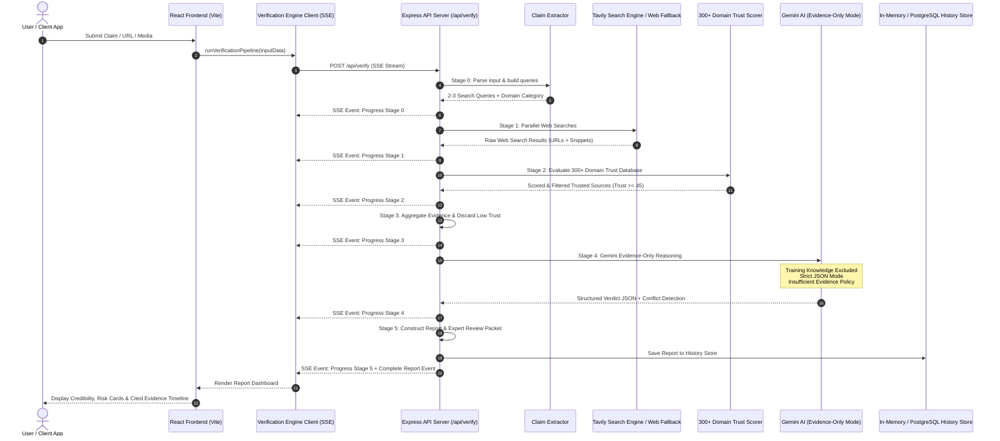

# TruthLens RAV System Architecture & Technical Specification

TruthLens is an enterprise-grade **Retrieval-Augmented Verification (RAV)** SaaS platform. It combines live internet search, 300+ domain trust scoring, and evidence-restricted LLM reasoning (Gemini 1.5/3.5/3.6 Flash) to verify claims, URLs, images, videos, and documents.

---

## High-Level Architecture Diagram

  

---

## Core Components

| Component | Technology | Responsibility |
|---|---|---|
| **Frontend UI** | React 18, Lucide Icons, Vanilla CSS Design System | Responsive 1440px glassmorphism interface, multi-modal input cards, animated progress rings, executive report dashboard. |
| **API Server** | Node.js, Express, SSE Streaming | High-throughput async REST server with Server-Sent Events streaming real-time stage updates. |
| **Search Engine** | Tavily Search API + DDG / Wikipedia Fallback | Live web retrieval returning page content, URLs, scores, and publication dates. |
| **Trust Scorer** | Custom Tiered Domain Engine | Evaluates 300+ domains across 5 trust tiers (Official/Academic 90-100, Major News 80-92, Fact-Checkers 88-94, Tech/Business 70-85, Blocked <20). |
| **AI Reasoning Engine** | Google Gemini (3.5/3.6 Flash) | Strict JSON mode prompt enforcing evidence-only reasoning, score calibration, and conflict detection. |
| **URL Reputation** | Pattern & Signal Audit | Detects credential phishing keywords, suspicious TLDs, IP address hostnames, and TLS certificate security. |
| **Media Forensics** | EXIF & Signal Analysis | Evaluates image error level patterns, vocal formant spectrums, inter-frame video coherence, and PDF ISO structures. |

---

## API Endpoint Matrix

| Method | Endpoint | Description |
|---|---|---|
| `GET` | `/api/health` | Service health status, API key detection, and readiness flags. |
| `POST` | `/api/verify` | Primary SSE-streaming RAV pipeline endpoint. |
| `GET` | `/api/history` | Retrieves recent verification reports. |
| `GET` | `/api/history/:id` | Retrieves a specific verification report by Request ID. |
| `DELETE` | `/api/history/:id` | Deletes a report from history. |
| `POST` | `/api/url-audit` | Standalone URL reputation and phishing audit. |
| `POST` | `/api/forensics` | Standalone media forensics and metadata audit. |
